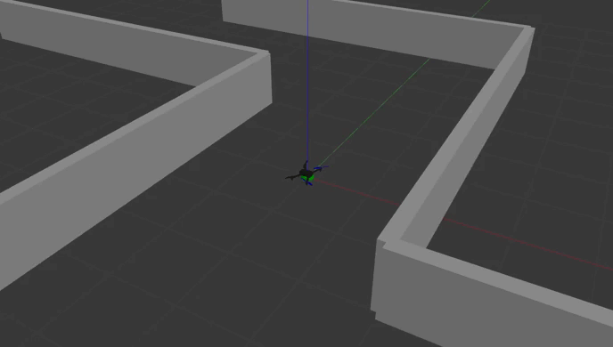

# UAV - PX4

## Project Overview

This project provides a C++ based UAV simulation and control framework built on ROS 2 and PX4, designed to support both research and practical applications in autonomous flight. It offers a flexible environment for developing, testing, and validating algorithms for path planning and control, allowing UAVs to generate safe trajectories and maintain stable performance during missions. The framework integrates with Gazebo Classic for high-fidelity simulation, supports custom maps and vehicle models, and leverages Micro XRCE-DDS for communication between PX4 and ROS 2.

## Project Setup

### Step 1: Download firmware & Setup

- Clone this repository into a shared root directory, for example:
```
git clone https://github.com/mmhai202/uav-px4-offboard.git
```

- Install the base requirements on Ubuntu 22.04
```
cd ~/uav-px4-offboard
./scripts/setup_requirements.sh
```

- The script will:
  - configure the `en_US.UTF-8` locale
  - enable the Ubuntu `universe` repository
  - add the ROS 2 apt repository and key
  - update and upgrade apt packages
  - install `ros-humble-desktop` and `ros-dev-tools`
  - install the pinned Python tools needed for building ROS 2 workspaces, including `colcon`, `empy`, `pyros-genmsg`, and `setuptools`
  - add `source /opt/ros/humble/setup.bash` to `~/.bashrc` if it is not already present

- Run the firmware setup script:
```
cd ~/uav-px4-offboard
./scripts/setup_firmware.sh
```

- The script will:
  - clone [PX4 firmware](https://docs.px4.io/main/en/dev_setup/building_px4.html) (v1.15.1) into the shared parent directory if needed, by default `~/DevPX4/PX4-Autopilot`
  - patch the PX4 Python requirements line `matplotlib>=3.0.*` to `matplotlib>=3.0` for compatibility with newer pip versions
  - run `PX4-Autopilot/Tools/setup/ubuntu.sh`
  - install [Gazebo-Classic 11](https://docs.px4.io/main/en/sim_gazebo_classic/) packages
  - clone and build [Micro-XRCE-DDS-Agent](https://docs.px4.io/main/en/ros2/user_guide.html#setup-micro-xrce-dds-agent-client) (v2.4.3) if needed
  - build PX4 once with `make px4_sitl_default gazebo-classic_iris`

- If your shared parent directory is not the parent of this repository, pass it explicitly:
```
./scripts/setup_firmware.sh /path/to/shared-root
```

- Run the setup script from this repository:
```
cd ~/uav-px4-offboard
./scripts/setup_px4.sh
```

- The script assumes the standard PX4 directory tree already exists, by default `~/DevPX4/PX4-Autopilot`, and copies the prepared files from `config/` into it, including:
  - `my_world/my_world.world`
  - `my_vehicle/`
  - `10050_gazebo-classic_my_vehicle`
  - `CMakeLists.txt`
  - `sitl_targets_gazebo-classic.cmake`
  - `sitl_run.sh`

- These files overwrite the matching files in PX4.
- This copy-based config is intended for `PX4-Autopilot v1.15.1`.

- If your PX4 directory is not `../PX4-Autopilot`, pass it explicitly:
```
./scripts/setup_px4.sh /path/to/PX4-Autopilot
```

### Step 2: Build and Run project

Open some terminals

- Terminal 1: run PX4 firmware
```
cd ~/PX4-Autopilot
make px4_sitl_default gazebo-classic_my_vehicle__my_world
```

- Terminal 2: run the communication between ROS 2 and PX4
```
MicroXRCEAgent udp4 -p 8888
```

- Terminal 3: run the `uav-px4-offboard` project
```
cd ~/uav-px4-offboard
colcon build
source install/setup.bash
ros2 run uav_control uav_control
```


### Step 3: Upload firmware to Pixhawk
```
cd ~/PX4-Autopilot
make <px4_board> upload
```